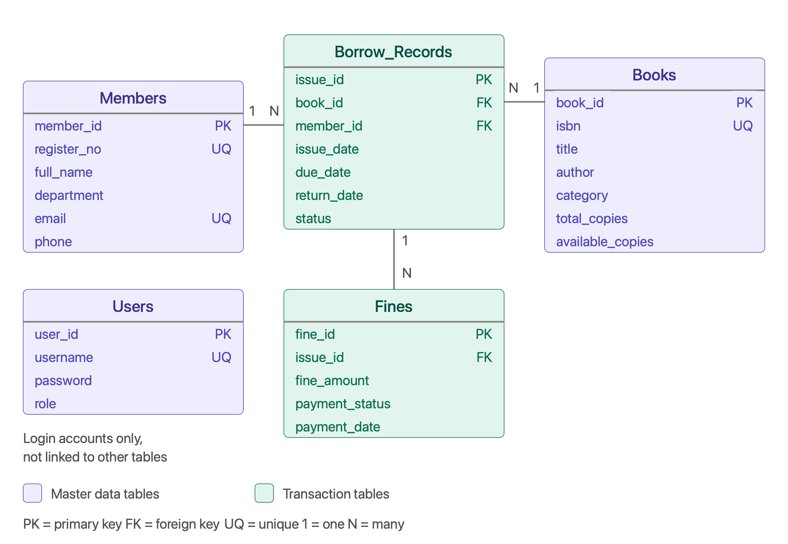

# Normalization to 3NF - Library Management and Fine Tracking System

This document shows how the library data is normalized step by step, from one big unnormalized record to the five tables in `tables.sql` (see `er_diagram.png`).

## 1. Business rules used

- A member (student or staff) has a unique register number and a unique email.
- A book is identified by its ISBN. In this design each book has one author and one category.
- The library can hold several copies of a book. `total_copies` is how many it owns, and `available_copies` is how many are on the shelf.
- A member can borrow many books, and a book can be borrowed by many members over time. Each loan is one record with an issue date, due date and return date.
- A late return can produce one or more fines. Each fine has an amount and a payment status.
- Admins and librarians log in with a username and a password.

## 2. Unnormalized form (UNF)

Everything is in one record. Braces `{ }` mark repeating groups.

```
LIBRARY(member_id, register_no, full_name, department, email, phone,
        { book_id, isbn, title, author, category, total_copies, available_copies,
          issue_date, due_date, return_date, status,
          { fine_amount, payment_status, payment_date } })
```

Problems with this form:

- **Repeating groups:** a member has many loans, and a loan has many fines.
- **Update anomaly:** changing one member's phone number means changing every loan row of that member.
- **Insertion anomaly:** a new member who has not borrowed anything yet cannot be stored.
- **Deletion anomaly:** deleting the only loan of a book also deletes the book's details.

## 3. First Normal Form (1NF)

Rule: every value is atomic, there are no repeating groups, and each relation has a key.

Each repeating group becomes its own relation, and the parent's key is carried into it.

```
LOAN_1NF(member_id, book_id, issue_date,
         register_no, full_name, department, email, phone,
         isbn, title, author, category, total_copies, available_copies,
         due_date, return_date, status)
  Key: (member_id, book_id, issue_date)

FINE_1NF(member_id, book_id, issue_date, fine_no,
         fine_amount, payment_status, payment_date)
  Key: (member_id, book_id, issue_date, fine_no)
```

## 4. Second Normal Form (2NF)

Rule: 1NF, and no non-key attribute depends on only part of a composite key.

In `LOAN_1NF` two partial dependencies exist:

- `member_id -> register_no, full_name, department, email, phone`
- `book_id -> isbn, title, author, category, total_copies, available_copies`

These attributes are moved out into their own relations:

```
MEMBERS(member_id, register_no, full_name, department, email, phone)
BOOKS(book_id, isbn, title, author, category, total_copies, available_copies)
LOAN(member_id, book_id, issue_date, due_date, return_date, status)
FINE(member_id, book_id, issue_date, fine_no, fine_amount, payment_status, payment_date)
```

To keep foreign keys short, single-column keys replace the long composite keys:

- `issue_id` replaces `(member_id, book_id, issue_date)` in `LOAN`, which is renamed `BORROW_RECORDS`.
- `fine_id` replaces `(issue_id, fine_no)` in `FINE`, which is renamed `FINES`.

The login accounts form their own relation, `USERS(user_id, username, password, role)`.

## 5. Third Normal Form (3NF)

Rule: 2NF, and no non-key attribute depends on another non-key attribute (no transitive dependencies).

Functional dependencies in each relation:

| Relation | Keys | Dependencies | 3NF? |
|---|---|---|---|
| USERS | `user_id`; `username` (unique) | `user_id -> username, password, role` | Yes |
| MEMBERS | `member_id`; `register_no` and `email` (unique) | `member_id -> register_no, full_name, department, email, phone` | Yes |
| BOOKS | `book_id`; `isbn` (unique) | `book_id -> isbn, title, author, category, total_copies, available_copies` | Yes |
| BORROW_RECORDS | `issue_id` | `issue_id -> book_id, member_id, issue_date, due_date, return_date, status` | Yes* |
| FINES | `fine_id` | `fine_id -> issue_id, fine_amount, payment_status, payment_date` | Yes* |

Notes:

- `department` determines nothing else, because no department details are stored. If a department's head or building were stored, a separate `DEPARTMENTS` table would be needed.
- `isbn` is itself a key of `BOOKS`, so `isbn -> title, author, category` is not a transitive dependency.

\* **Derived columns kept on purpose.** Three columns can be worked out from other columns. They are a controlled redundancy, and the application sets them together with the column they depend on:

| Column | Derived from | Why it is kept |
|---|---|---|
| `BORROW_RECORDS.status` | `return_date` (empty means Issued) | Quick search for books that are still out; limited to Issued or Returned by a CHECK constraint |
| `FINES.payment_status` | `payment_date` (empty means Unpaid) | Quick search for unpaid fines; limited to Unpaid or Paid by a CHECK constraint |
| `BOOKS.available_copies` | `total_copies` minus the loans that are still open | Avoids counting loans on every search; a CHECK constraint keeps it at 0 or more |

If strict 3NF is required, drop these three columns and use `return_date IS NULL`, `payment_date IS NULL` and a count of open loans instead.

## 6. Final 3NF schema

```
USERS(user_id PK, username UNIQUE, password, role)
MEMBERS(member_id PK, register_no UNIQUE, full_name, department, email UNIQUE, phone)
BOOKS(book_id PK, isbn UNIQUE, title, author, category, total_copies, available_copies)
BORROW_RECORDS(issue_id PK, book_id FK -> BOOKS, member_id FK -> MEMBERS,
               issue_date, due_date, return_date, status)
FINES(fine_id PK, issue_id FK -> BORROW_RECORDS,
      fine_amount, payment_status, payment_date)
```

This is exactly the set of tables created in `tables.sql`.

The anomalies from section 2 are gone:

- A phone number is stored once, in `MEMBERS`.
- A member or a book can be added before any loan exists.
- Deleting a loan does not delete the book or the member.

## 7. Possible improvements beyond 3NF

- Add `AUTHORS` and `CATEGORIES` tables if a book can have several authors or categories.
- Add a `DEPARTMENTS` table so department names cannot be spelled in different ways.


